## Four Questions {.smaller}

Last week we learned to turn any truth table into a circuit: one AND per row that
should be 1, one OR to collect them. It always works.

This lecture is about what happens next.

1. **What does "smaller" even mean?** Gates, delay and power are three different
   things, and you cannot optimise all three at once.
2. **How do you find a smaller circuit by hand?** Algebra gets you part of the
   way. A **K-map** makes the rest mechanical.
3. **How hard is it, in general?** Harder than it looks, and stranger than you
   would guess.
4. **What if we turn the question around?** Given a formula, find an input that
   makes it true. That is **SAT**, and it is the most useful hard problem we
   know.

::: {.notes}
Frame the deck with the thing they already own: the truth-table-to-DNF recipe is
correct and total. Everything today is about the fact that it is also enormous.

The four questions are deliberately in this order: cost, method, hardness,
inversion. Each one makes the next one necessary. Say that the last two are the
"slightly advanced" part — they are not on the midterm, they are the answer to
"why do we stop at four variables and let a computer do the rest".
:::

# Part 0 — Why Bother

## The Truth Table Always Works {.smaller}

The **majority** function: the output is 1 when at least two of the three inputs
are 1.

| A | B | C | M |
|---|---|---|---|
| 0 | 0 | 0 | 0 |
| 0 | 0 | 1 | 0 |
| 0 | 1 | 0 | 0 |
| 0 | 1 | 1 | 1 |
| 1 | 0 | 0 | 0 |
| 1 | 0 | 1 | 1 |
| 1 | 1 | 0 | 1 |
| 1 | 1 | 1 | 1 |

Four rows have a 1, so the canonical sum of products has four terms:

::: {.formula}
¬A∧B∧C ∨ A∧¬B∧C ∨ A∧B∧¬C ∨ A∧B∧C
:::

Twelve literals. Four 3-input AND gates, three NOT gates, one 4-input OR gate.

::: {.fragment}
Correct — and **twice the size it needs to be**.
:::

::: {.notes}
This is a recap, not new material: do not re-teach DNF. Point at the four 1-rows
and say "one term per 1-row, that is the recipe, and it never fails".

Then count out loud. Each term is a 3-input AND; the terms are collected by a
4-input OR; the negations need three NOTs. Eight gates, twelve literals.

The number to leave in their heads is *eight*, because four is coming.
:::

## What a Circuit Costs {.smaller}

| You pay in | Measured as | You feel it as |
|---|---|---|
| **Gates** | gate count, or transistor count | silicon area, money |
| **Depth** | gates on the longest input-to-output path | how long the answer takes |
| **Power** | switching activity × capacitance | heat, and battery |

Depth is the one that surprises people. A ripple-carry adder has the right number
of gates and gives the right answer, but its carry has to walk through every bit
before the last sum bit is known — the depth grows with the width of the adder.

::: {.fragment}
> Smaller, faster, cooler: pick two. Optimisation is always *against a cost
> function*, and the cost function is a choice you make.
:::

::: {.notes}
Tie this to the adder they built: the half adder is fine, the full adder is fine,
and the 32-bit adder is where the carry chain starts to hurt. That is depth, not
gate count, and no amount of algebraic simplification fixes it.

Ask the trade question directly: "if I could halve the gates but double the
delay, should I?" The answer is "depends what you are short of", and that is the
whole point of the slide.

Keep this slide short. It exists so that "smaller" later means "fewer gates
*and/or* less depth", not just "fewer gates".
:::

## Eight Gates or Four {.smaller}

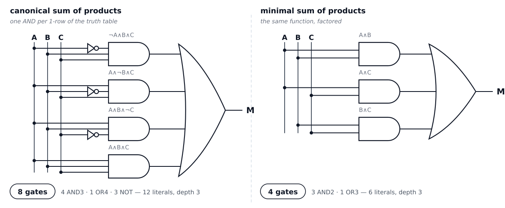{height=470px}

::: {.fragment}
> Same eight rows. Same four 1s. The circuit on the left is the truth table
> written as gates; the circuit on the right is the *function*.
:::

::: {.notes}
Walk the two panels: four AND gates and one OR against three AND gates and one
OR; twelve literals against six.

Both have depth 3, so this is a pure area win — which is exactly why the question
"what are we optimising" had to come first.

Then the question that sets up the whole lecture: where did the other four gates
go? The four terms share parts. The next two parts are two ways of finding the
sharing: one you already know, one you probably do not.
:::

# Part I — Algebra

## The Rules That Do the Work {.smaller}

| Rule | AND form | OR form |
|---|---|---|
| identity | X ∧ 1 = X | X ∨ 0 = X |
| null | X ∧ 0 = 0 | X ∨ 1 = 1 |
| idempotent | X ∧ X = X | X ∨ X = X |
| complement | X ∧ ¬X = 0 | X ∨ ¬X = 1 |
| **absorption** | X ∧ (X ∨ Y) = X | X ∨ (X ∧ Y) = X |
| **De Morgan** | ¬(X ∧ Y) = ¬X ∨ ¬Y | ¬(X ∨ Y) = ¬X ∧ ¬Y |
| distributive | X ∧ (Y ∨ Z) = (X∧Y) ∨ (X∧Z) | X ∨ (Y∧Z) = (X∨Y) ∧ (X∨Z) |

Two of these do almost all of the real work: **absorption**, which lets you throw
away a term that is already covered, and **De Morgan**, which pushes a NOT
inwards until it sits on a single variable.

::: {.notes}
Nothing on this table is new information. Every row is provable by a two- or
four-row truth table, and they have written those tables.

The pitch is that this is new *leverage*: a truth table tells you what a function
does, an identity tells you when two functions are the same, and only the second
one lets you move.

If someone asks why the two highlighted rules: absorption is how a redundant term
dies, and De Morgan is how a negated bracket becomes something you can group.
Every simplification they will do today uses one of the two.
:::

## Canonical to Minimal, Step by Step {.smaller}

Start: `¬A∧B∧C ∨ A∧¬B∧C ∨ A∧B∧¬C ∨ A∧B∧C`

| Step | Pair up | Factor out | Rule used |
|---|---|---|---|
| 1 | ¬A∧B∧C ∨ A∧B∧C | B∧C | complement: X ∨ ¬X = 1 |
| 2 | A∧¬B∧C ∨ A∧B∧C | A∧C | complement |
| 3 | A∧B∧¬C ∨ A∧B∧C | A∧B | complement |

Steps 1, 2 and 3 all use the term `A∧B∧C`. That is allowed, because
**X = X ∨ X**: one term can be used as many times as you like.

::: {.fragment}
::: {.formula}
M = B∧C ∨ A∧C ∨ A∧B
:::

Three terms, six literals, four gates. The same function.
:::

::: {.notes}
This is the "show your work" version, in the style of the homework and the exam.

The step students never invent on their own is the reuse: `A∧B∧C` appears in all
three pairings. Say it plainly — idempotence means a term can be duplicated for
free, and duplication is what makes the factoring work. If they only take one
trick from this slide, take that one.

Sanity check worth saying: majority is symmetric in A, B and C, so the answer has
to be symmetric too. `B∧C ∨ A∧C ∨ A∧B` is. A lopsided answer would be a warning
sign.

Also worth naming: the three terms are exactly the three pairs of inputs. "Any
two of the three" is what majority means.
:::

## Why Algebra Is Not an Algorithm {.smaller}

Three problems, and they are really the same problem:

- **You have to see the next move.** No rule says "apply absorption *here*". The
  order matters, and nothing tells you the order.
- **Every step is an equivalence.** You are never *nearer* the answer, because
  every intermediate form is equally correct. There is no gradient to follow.
- **"Minimal" is undefined.** Minimal in what — literals, gates, depth? Three
  different answers, three different circuits.

::: {.fragment}
> Algebra is a good way to *check* a simplification. It is a poor way to *find*
> one.
:::

::: {.notes}
This is the honest motivation for the K-map, so do not rush it.

The second bullet is the deep one: in ordinary algebra you simplify `2x + 3x` to
`5x` because shorter is better, but here every form is *equal*, so "shorter" is a
property of the notation rather than of the mathematics. There is no measure that
decreases as you work.

The third bullet is where marking hurts: two students simplify correctly and
produce different circuits. Both right, neither provably best. We want a method
that is mechanical enough that the whole class gets the same answer.
:::

# Part II — K-Maps

## The Whole Trick {.smaller}

{height=340px}

Two terms that differ in exactly one variable collapse into one term with one
fewer literal:

::: {.formula}
A∧B ∨ A∧¬B = A∧(B ∨ ¬B) = A
:::

So if you could *see* which of your 1s are one variable apart, minimising would
be a matter of drawing loops around them.

::: {.notes}
This single identity is the entire theory of the K-map. Everything else is
bookkeeping about how to draw the picture.

Say it as a rule: two cells merge if their labels differ in exactly one variable,
and the variable that differs disappears from the term.

Then the design question: how would you lay out a truth table so that the cells
that differ in one variable are *next to each other*? That is the next slide.
:::

## Lay the Table Out So Neighbours Touch {.smaller}

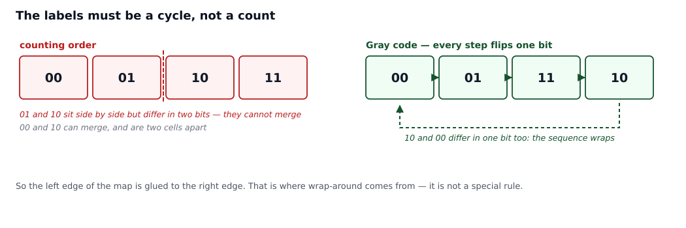{height=340px}

Count the labels in **Gray code** — `00, 01, 11, 10` — so that each step flips
exactly one bit. Then a shared edge on the map means "differs in one variable",
which is exactly the condition for merging.

The last label wraps round to the first: `10` and `00` differ in one bit too.

::: {.notes}
The left panel is the trap: in ordinary counting order, `01` and `10` are next to
each other on the page but differ in *two* bits, so they cannot merge, while `00`
and `10` can merge but are at opposite ends.

Gray code fixes it by construction. Point out that the four labels form a cycle,
which is why the left and right edges of the map are the same edge. That single
fact explains wrap-around, and it is the thing students forget in the exam.

If someone asks why not use three variables on one axis: because then the labels
would be three bits and you would need eight columns, which no longer fits on a
slide or in a head.
:::

## The Three-Variable Map {.smaller}

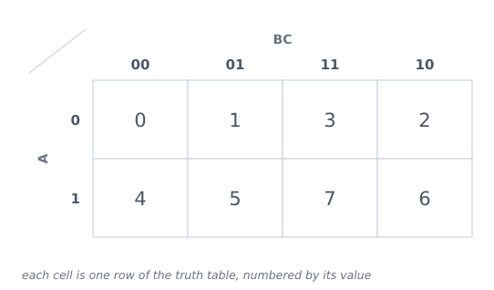{height=440px}

One variable drives the rows and two drive the columns. Each cell is one row of
the truth table; the small number in the corner is that row's **minterm number** —
its binary value read as a number.

::: {.notes}
Read the map with them, cell by cell, for the first two or three cells only. Then
let them place the rest: "where is 101?" (bottom row, third column).

Two things to point at explicitly: `000` and `111` are diagonally opposite, so
they are as far apart as possible — which is right, because they differ in three
variables. And the columns are deliberately *not* in binary order, which is the
one thing that looks wrong until they remember the last slide.

The minterm numbers are there so they can go straight from a truth table row to a
cell without re-deriving the labels. On the exam they will be given the map with
the labels; the numbers are training wheels.
:::

## Fill It In {.smaller}

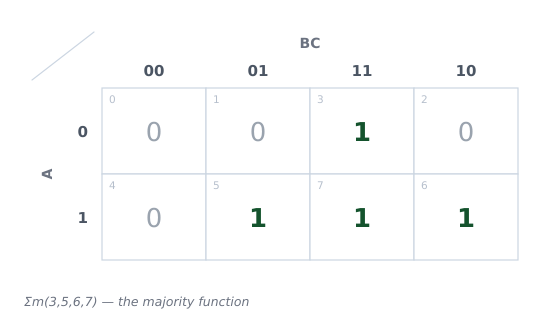{height=440px}

The majority function: four 1s, at minterms 3, 5, 6 and 7.

Nothing has happened yet. This is the same truth table, folded.

::: {.notes}
Emphasise that no simplification has occurred: this is the truth table, just
arranged so that the geometry means something.

Ask them to find the four 1-rows from the first slide in this picture. They are
the four cells with a 1 in them — and now they are *near each other* in a way
they were not in the table.
:::

## Grouping Rules {.smaller}

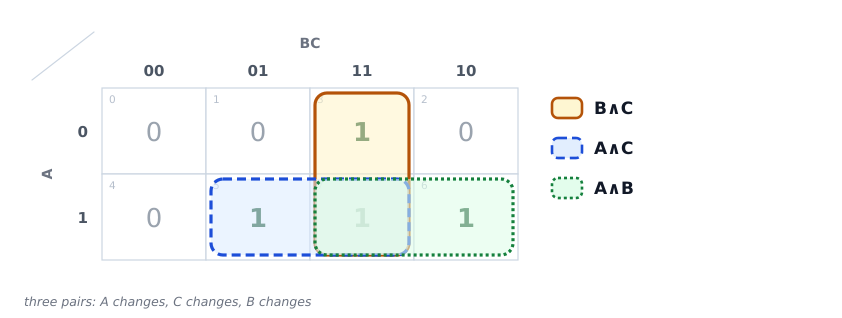{height=430px}

- A group holds **1, 2, 4, 8, …** cells — always a power of two.
- Make each group **as large as possible**, then use **as few groups as possible**.
- Groups may **overlap**. Every 1 must be in at least one group.
- A group of 2 drops one variable; a group of 4 drops two; a group of 8 drops
  three.

::: {.notes}
Walk the three groups one at a time and read the term off each: the vertical pair
is `B∧C` (A changes, so A drops); the pair on the right is `A∧C`; the pair on the
bottom is `A∧B`.

Then the punchline: these are *exactly* the three terms from the algebra slide,
found with no search at all. The map did the factoring for you.

Cell 7 is in all three groups. That is the "use the term three times" trick from
Part I, made visible: overlapping groups are free, and overlap is what lets a
single 1 serve three terms.

The "as large as possible" rule matters more than "as few as possible" in
practice: a big group always drops more variables than several small ones.
:::

## The Edges Wrap {.smaller}

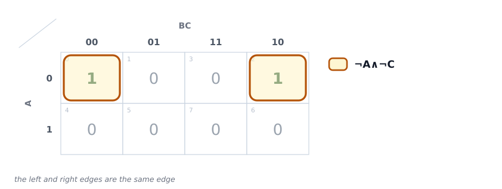{height=430px}

`Σm(0,2)` — two 1s at opposite ends of the top row. They are neighbours, because
the left and right edges are the same edge: `00` and `10` differ in one bit.

::: {.formula}
¬A∧¬B∧¬C ∨ ¬A∧B∧¬C = ¬A∧¬C
:::

The map is really a cylinder. A four-variable map is a torus.

::: {.notes}
The most-missed idea in the whole topic, so give it its own slide.

Physically: the label sequence is a cycle, so the right edge is glued to the left
edge. On a 3-variable map the top and bottom edges are *not* glued (the row
labels are not a cycle, because there is only one row variable). On a 4-variable
map both axes are cycles, so all four edges are glued — that is the torus.

The term drops B because B is the variable that differs between the two cells.
Read it as: "A is 0 and C is 0, and B does not matter".
:::

## You Try It {.smaller}

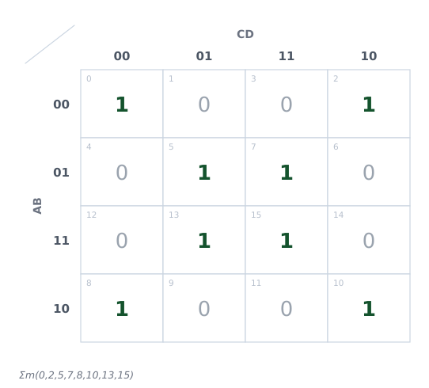{height=440px}

Four variables, eight 1s, already filled in.

::: {.notes}
Hands-on, and do not talk during it. Circulate.

The expected wrong answer is four groups of two, which is what you get if you
group locally and never look at the edges. That is fine — it is the answer the
map wants you to give before you notice the corners.

Hints, in order of how much they give away: "look at the corners", "the top edge
is glued to the bottom edge", "how big a group can you make".
:::

## The Answer {.smaller}

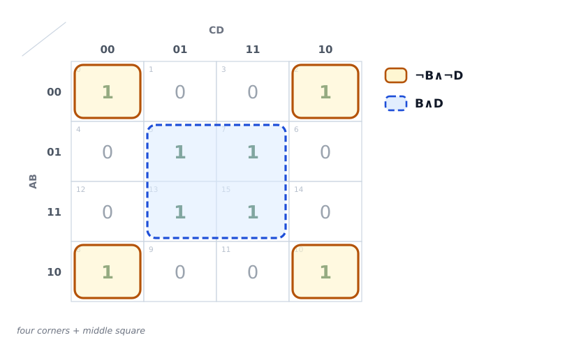{height=440px}

Two groups of four: the four corners, and the middle square.

::: {.formula}
M = ¬B∧¬D ∨ B∧D
:::

::: {.notes}
The corner group is the payoff: four cells that look scattered are one group,
because both edges wrap. Say out loud that this group is a 2×2 block that has been
cut into four pieces by the edges of the page.

The answer has a reading: the output is 1 when B and D *agree*. That is worth
saying because it is a check — if your groups produce a term with A or C in it,
you missed something, since A and C do not affect this function at all.

Ask the room how many found the corners before drawing it. Then point out the
lesson: the map rewards looking at the whole picture, which is why it is faster
than algebra and slower than a tool.
:::

## Don't-Cares {.smaller}

The input is a **BCD digit**: `1010`–`1111` never arrive. An **×** is an input we
are *promised* will never happen, so count it as a 1 whenever it makes a group
bigger.

::: {.columns}
::: {.column width="50%"}
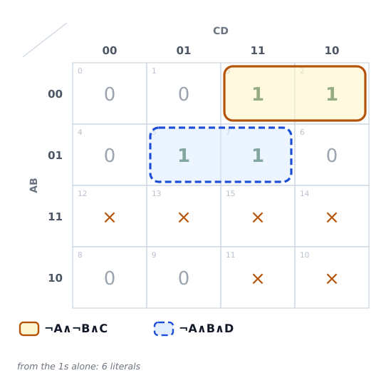{width=94%}
:::
::: {.column width="50%"}
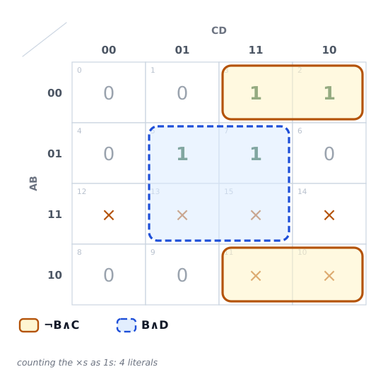{width=94%}
:::
:::

::: {.notes}
Two sources of don't-cares, and both are properties of the *system*, not of the
mathematics: inputs that cannot happen (a BCD digit is never 1010) and outputs
nobody reads (a display segment during a blanking interval).

The left map groups what it can from the 1s alone: two pairs, six literals. The
right map treats the ×s as free 1s, which lets both groups grow to four cells and
drop A entirely: four literals.

The warning to say out loud: an × is only free if it really cannot happen. If a
glitch ever delivers 1010, the circuit will do something arbitrary there, and
that is a real bug in a real chip. Don't-cares are a promise about the
environment.
:::

## What K-Maps Can't Do {.smaller}

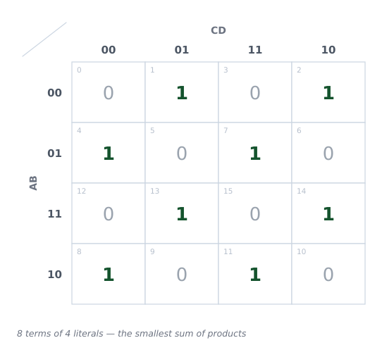{height=380px}

**Parity of four bits** is a checkerboard: no two 1s are adjacent, so every group
is a single cell. Eight terms, thirty-two literals — and that really is the
smallest *sum of products*.

But `A ⊕ B ⊕ C ⊕ D` is three gates. The map cannot see it, because the map only
ever produces two levels of logic.

::: {.notes}
The deepest point in Part II, and the bridge to Part III.

Parity is the standard counterexample to "minimal SOP means minimal circuit". The
map is not wrong: eight terms of four literals genuinely is the smallest
two-level form. It is just that two levels is the wrong shape for this function,
because the sharing is between *gates*, not between terms.

Multi-level sharing — one sub-expression used in several places — is what real
synthesis tools do, and it is the reason a K-map is a teaching tool rather than an
industrial one.

Also say the scale limit plainly: five variables needs two maps side by side,
six needs four, and nobody does that by hand. Four variables is the practical
limit, which is why the exam question will be four.
:::

# Part III — How Hard Is It?

## You Can't Even Write the Input Down {.smaller}

A function of *n* inputs has a truth table with **2ⁿ rows**.

| Inputs | Rows in the truth table | Functions of that many inputs |
|---|---|---|
| 3 | 8 | 256 |
| 4 | 16 | 65,536 |
| 8 | 256 | about 10⁷⁷ |
| 32 | 4.3 × 10⁹ | about 101.3 × 10⁹ |
| 64 | 1.8 × 10¹⁹ | — |

A 32-bit adder has 65 inputs. Its truth table has **2⁶⁵ ≈ 3.7 × 10¹⁹ rows** — at
one row per nanosecond, about a thousand years to write down.

::: {.fragment}
So for anything real, "minimise the truth table" is not slow. It is **impossible
to even state**.
:::

::: {.notes}
The numbers are the argument, so let them land: 10⁷⁷ is roughly the number of
atoms in the observable universe (about 10⁸⁰), for a function of *eight* inputs.

Point out that the middle column grows as 2ⁿ and the right column grows as
2^(2ⁿ) — the second is a tower, and that is where "there are more Boolean
functions than there are things" comes from.

The 32-bit adder is the concrete one, because they built one: 64 data inputs plus
a carry-in, so 2⁶⁵ rows.

This slide is the honest answer to "why not just always use the truth table": for
three or four inputs, always use the truth table.
:::

## The Honest Answer {.smaller}

**Finding the smallest sum of products is NP-hard.** Every exact method we know —
Quine–McCluskey, Petrick's method, branch and bound — can be forced to take time
that grows exponentially with the number of inputs.

"NP-hard" in one line: *no known method is fast on every input, and finding one
would settle the biggest open question in computer science.*

::: {.fragment}
And the general question is stranger than hard — it is **not even known to be
NP-complete**. "Is there a circuit of at most k gates for this function?" is in NP
(guess a circuit, check it on every row), but nobody knows whether it is as hard
as SAT. The hardness of circuit minimisation is itself an open problem.
:::

::: {.notes}
Be careful and precise here; this is the slide a sharp student will push on.

What we know: exact two-level minimisation is NP-hard, and the classic exact
methods (Quine–McCluskey enumerating prime implicants, Petrick's method solving
the resulting covering problem) blow up in the worst case. That is a theorem.

What we do not know: whether the *general* problem — smallest circuit of any
shape — is NP-complete. It is in NP, and it is the famous example of a natural
problem that nobody has shown to be complete. So the honest sentence is "we do
not know how hard the general question is".

Do not let this become "computers cannot do it". The next slide is the answer.
:::

## So What Do We Actually Do? {.smaller}

We stop asking for the best circuit and start asking for a **good enough** one,
fast.

- **Espresso** (1980s) — heuristic two-level minimisation. The K-map's industrial
  replacement.
- **ABC**, **Yosys** — multi-level synthesis: they share sub-expressions across
  outputs, which no K-map can do.
- Typical result: within a few percent of optimal, on functions with hundreds of
  inputs, in milliseconds.

::: {.fragment}
> Optimal is rarely the goal. Meeting an area and timing **target** is the goal.
:::

::: {.notes}
The chip in their phone has on the order of 10¹⁰ transistors and no human being
minimised any of it. It was all heuristic search, run by a tool, checked by other
tools.

The pattern to name: heuristics plus local search, which is the same idea as an
optimising compiler. Nobody proves the compiler's output is optimal either.

And the engineering point: the target is a specification, not a minimum. If the
design closes timing with a few percent more area, it ships.
:::

# Part IV — Satisfiability

## A Different Question {.smaller}

Every question so far started with a *function* and asked for a *circuit*.

**SAT** starts with a formula and asks for an **input**:

> Given a Boolean formula, is there any assignment of 0s and 1s to its variables
> that makes it **true**?

::: {.formula}
(A ∨ B) ∧ (¬A ∨ C) ∧ (¬B ∨ ¬C)
:::

Try `A = 1, B = 0, C = 1`: the three clauses become `1`, `1`, `1`.
**Satisfiable.**

::: {.fragment}
If no assignment works, the formula is **unsatisfiable** — and *proving* that is
the hard part.
:::

::: {.notes}
The direction change is the whole slide. Before: the function is given, find a
small circuit. Now: the formula is given, find an input.

Then the asymmetry, which is the seed of everything in the next two slides:
*checking* an answer is trivial — substitute and evaluate. *Finding* one, or
proving there is none, is not. That gap between checking and finding is exactly
what NP means.

Do the substitution on the slide with them; it takes ten seconds and makes the
definition concrete.
:::

## CNF: The Input Format {.smaller}

- A **literal** is a variable or its negation: `A`, `¬A`.
- A **clause** is literals joined by OR: `(A ∨ ¬B ∨ C)`.
- **CNF** is clauses joined by AND: `(A ∨ ¬B) ∧ (¬A ∨ C)`.
- **3-SAT**: every clause has exactly three literals.

You have already written this form. It is the one your truth table produces when
you read off the **0** rows instead of the 1 rows.

::: {.fragment}
Why CNF? Because any formula converts into it mechanically, and because each
clause is then one small, local constraint. Every SAT solver takes CNF.
:::

::: {.notes}
Make the connection explicit, because it is the reason this part of the lecture
belongs in this course at all: DNF is the sum of the 1-rows, CNF is the product
of the 0-rows, and they built both from the same truth table.

Why clauses are the right shape: a clause says "at least one of these three
things must be true", which is a local constraint you can reason about without
looking at the rest of the formula. That locality is what makes unit propagation
work.

3-SAT is the standard form because any CNF can be converted to three literals per
clause with a few extra variables, so nothing is lost by insisting on it.
:::

## The First NP-Complete Problem {.smaller}

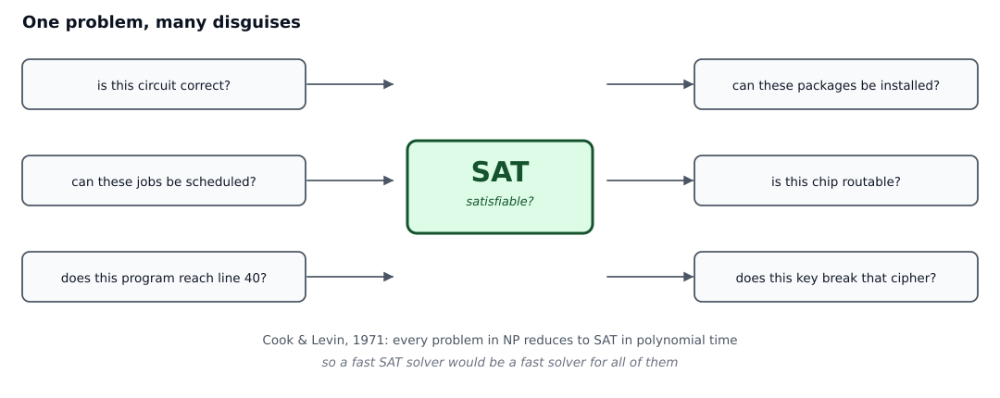{height=380px}

Cook and Levin, 1971: **every** problem in NP can be translated into SAT in
polynomial time, so a fast SAT solver would be a fast solver for all of them.

::: {.notes}
One line on NP, since they have not had it formally: a problem is in NP when a
proposed answer can be *checked* quickly. SAT qualifies — substitute and evaluate.

Cook and Levin's theorem is that SAT is not just in NP, it is *universal* for NP:
every other problem there reduces to it. So SAT is both the canonical hard
problem and the standard target to encode other problems into.

Consequence worth stating: a fast-enough SAT solver would factor large numbers,
and that would break RSA. It would also settle P versus NP. That is why the
question is not academic.
:::

## The Surprise: The Solvers Work {.smaller}

Modern solvers — **DPLL** with unit propagation, and **CDCL**, which learns a new
clause from every conflict — routinely solve instances with **millions of
variables**.

They are inside chip verification and place-and-route, software model checking,
package managers, scheduling, planning, cryptanalysis, and every puzzle solver
you have ever used.

::: {.fragment}
> A problem can be NP-complete and still be *easy in practice*. Hardness is a
> claim about the **worst case**, and the instances people care about are rarely
> the worst case.
:::

::: {.notes}
The two mechanisms, in one sentence each, are enough: unit propagation is "a
clause with one unassigned literal forces that literal", and clause learning is
"when you hit a conflict, write down why, so you never make that mistake again".

The applications list is the part that makes it real: a package manager deciding
whether your dependencies can be installed is solving SAT, and it fails with a
"conflict" message for exactly the reason this slide describes.

Land the fragment hard, because the next slide is the other half of it.
:::

## The Gap {.smaller}

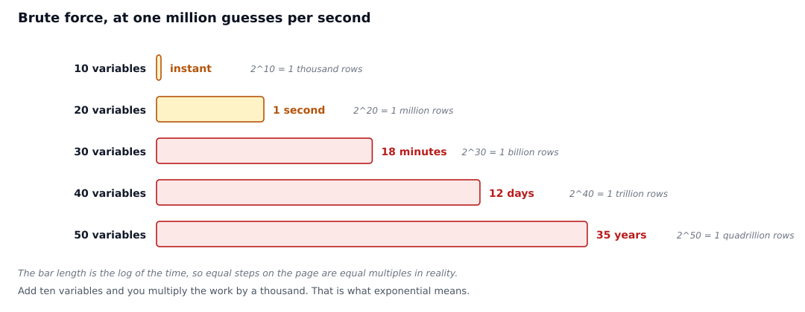{height=380px}

Brute force at one million guesses per second, and the search space doubles with
every variable: twenty variables is a second, forty is a fortnight.

Nobody knows whether a fundamentally better method exists. That question is
**P = NP**. It is open, and it is worth a million dollars.

::: {.notes}
The honest position, in two halves. Brute force is hopeless — the table makes
that concrete. Real solvers are exponential in the worst case too; they are just
extremely good at the structured instances that arise in practice, because
real problems have lots of local constraints and few genuine choices.

So "SAT is hard" and "SAT is solved" are both true, and the word doing the work
in both sentences is *worst case*.

Close the loop with the first half of the lecture: this is the same tension as
"minimal circuits are NP-hard, and synthesis tools work". Hardness tells you not
to expect a guarantee; engineering tells you to try anyway.
:::

# Part V — Wrap-Up

## Four Things to Remember {.smaller}

1. The truth table is always correct and always too big.
2. A K-map is a truth table **folded so that mergeable terms touch** — Gray code,
   powers of two, wrap-around.
3. Exact minimisation is NP-hard, and minimal *circuits* are not even known to be
   NP-complete. So we use heuristics and accept "good enough".
4. SAT asks the question backwards. It is the canonical hard problem and also the
   workhorse — because worst case and typical case are different questions.

::: {.notes}
If they remember one sentence, make it number 2: the K-map is not a new kind of
object, it is the truth table rearranged.

Number 4 is the one to leave them with, because it is the idea that keeps
recurring in the rest of the course: a hard problem is not the same thing as an
unsolvable one.
:::

